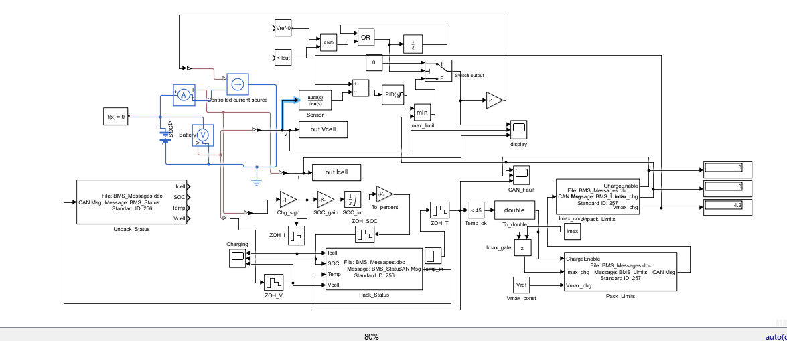
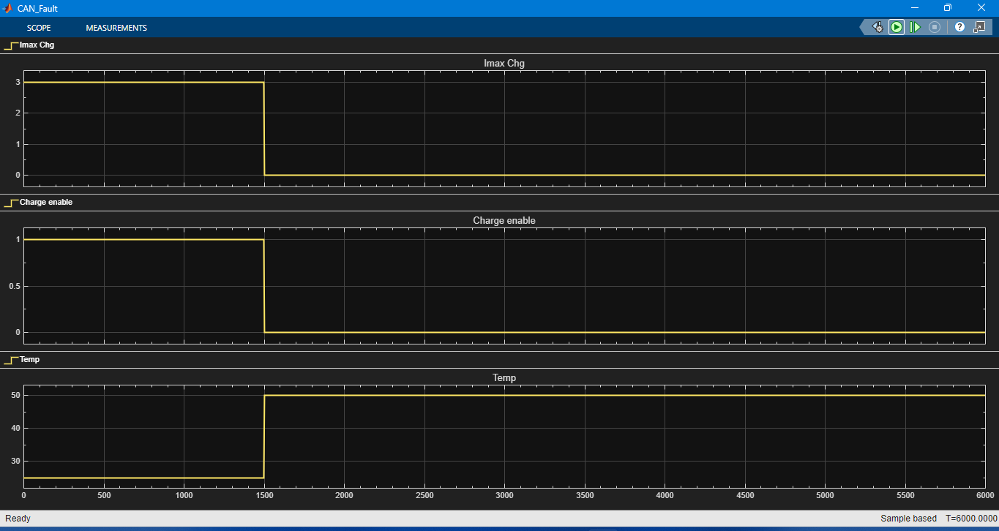
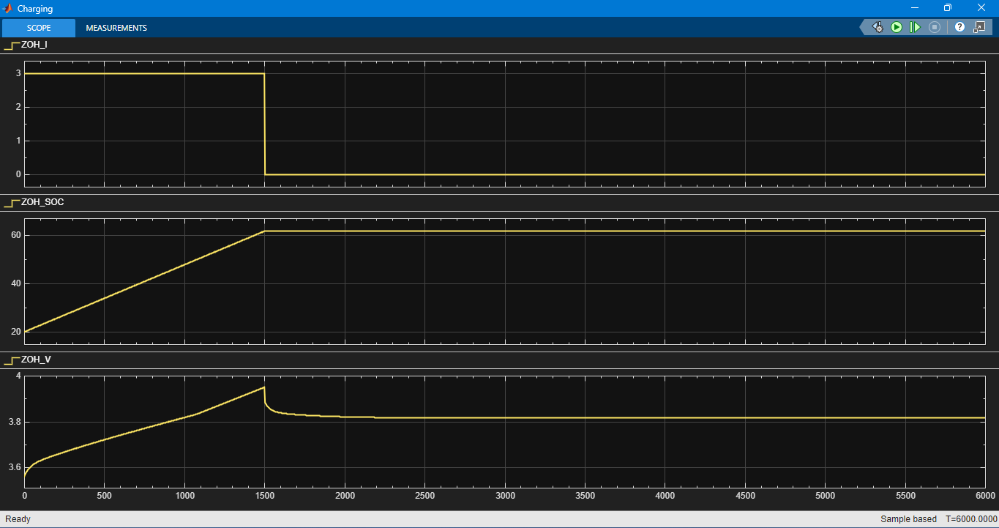

# BMS-Controlled CC-CV Li-ion Charger with CAN Communication (MATLAB/Simulink)

A 2RC equivalent-circuit Li-ion cell is charged by a PI-based CC-CV controller. A BMS block estimates SOC and sends charge limits to the charger over CAN. When an overtemperature fault is injected, the BMS disables charging and the charger cuts the current within one CAN cycle.



## System
```
Charger --current--> Cell (2RC) --V, I--> BMS (SOC, limits) --CAN 0x101 BMS_Limits--> Charger
                                              |
                                              +--CAN 0x100 BMS_Status--> vehicle / logger
```

The charger does not decide its own limits. It follows the voltage and current limits the BMS sends over CAN, which is how real chargers work.

## How it works
| Part | What it does |
|---|---|
| **Cell** | Table-based Simscape battery with two RC pairs (fast and slow polarization), controlled current source, voltage and current sensors |
| **BMS** | Samples voltage, current and temperature every 0.1 s, estimates SOC by coulomb counting, checks the temperature, and produces the limits Vmax_chg, Imax_chg and ChargeEnable |
| **CAN** | CAN Pack / Unpack blocks (Vehicle Network Toolbox) encode the BMS signals into 8-byte frames using `BMS_Messages.dbc` |
| **Charger** | PI voltage loop with clamping anti-windup; its current command is the minimum of the PI output and the BMS current limit; a latch ends the charge at C/20 |

## CAN messages (`BMS_Messages.dbc`)
| Message | ID | Signal | Scaling |
|---|---|---|---|
| BMS_Status | 0x100 | Vcell | 0.001 V, unsigned 16-bit |
| | | Icell | 0.1 A, signed 16-bit |
| | | SOC | 0.5 %, unsigned 8-bit |
| | | Temp | 1 degC, offset -40, unsigned 8-bit |
| BMS_Limits | 0x101 | Vmax_chg | 0.01 V, unsigned 16-bit |
| | | Imax_chg | 0.1 A, unsigned 16-bit |
| | | ChargeEnable | 0 / 1, unsigned 8-bit |

Standard 11-bit IDs, 8 bytes, little-endian, one message every 100 ms.

## Parameters
| Item | Value |
|---|---|
| Cell capacity | 3 Ah |
| R0 | 0.02 ohm |
| R1 / tau1 | 0.015 ohm / 30 s |
| R2 / tau2 | 0.010 ohm / 300 s |
| OCV table | SOC [0 0.2 0.5 0.8 1.0] -> [3.0 3.5 3.7 4.0 4.2] V |
| Initial SOC | 20 % |
| Charger limits | 4.2 V, 3 A (1C), cutoff at C/20 = 0.15 A |
| PI gains | Kp = 50, Ki = 5 |
| Temperature limit | charging allowed below 45 degC |

## Test: overtemperature fault at 1500 s
The temperature input steps from 25 to 50 degC at t = 1500 s while the cell charges at constant current.

### CAN limits


At 1500 s the temperature exceeds the limit. The BMS sets ChargeEnable to 0 and Imax_chg to 0, and the next CAN message carries the new limits to the charger.

### Charging response


- The charger delivers 3 A from the start and drops to 0 A at 1500 s after receiving the new limit.
- SOC rises linearly from 20 % to about 61.7 % (3 A x 1500 s = 1.25 Ah of 3 Ah) and stays constant after the cutoff.
- The cell voltage rises to about 3.95 V, drops by the I*R0 amount when the current stops, then relaxes slowly to about 3.82 V, the open-circuit voltage at that SOC (2RC relaxation).

## How to run
1. Download the repository and keep `BMS_Messages.dbc` in the same folder as the model. Make that folder the MATLAB current folder.
2. Set the parameters in the MATLAB Command Window:
   ```matlab
   Qcell = 3.0; R0cell = 0.02; SOC0 = 0.2;
   R1cell = 0.015; tau1 = 30; R2cell = 0.010; tau2 = 300;
   Vref = 4.2; Imax = 3; Icut = 0.15; Kp = 50; Ki = 5; Tsens = 0.05;
   ```
3. Open `bms_can_charger.slx` and run (variable-step ode23t, max step 0.1, stop time 6000 s).

To run without the fault, set the final value of the `Temp_in` step block to 25.

**Requires:** MATLAB, Simulink, Simscape, Simscape Electrical, Vehicle Network Toolbox.

## Repository contents
| File | Description |
|---|---|
| `bms_can_charger.slx` | Simulink model |
| `BMS_Messages.dbc` | CAN database (BMS_Status, BMS_Limits) |
| `model_overview.png` | Block diagram |
| `can_limits.png` | Temperature, charge enable and current limit over CAN |
| `fault_cutoff.png` | Charge current, SOC and cell voltage during the fault test |

## Limitations and next steps
- Temperature is a test input (fault injection), not a thermal model.
- The CAN blocks are connected directly, not through a virtual CAN channel.
- The charger's termination threshold uses the workspace `Vref`, not the CAN value.
- The results shown cover the fault case; the full CC-CV charge to the C/20 cutoff follows the charger design from my earlier work.

## Related
Cell models used in this project: [Lithium-1rc-vs-2rc-simulink](https://github.com/alisherbtu/Lithium-1rc-vs-2rc-simulink)
